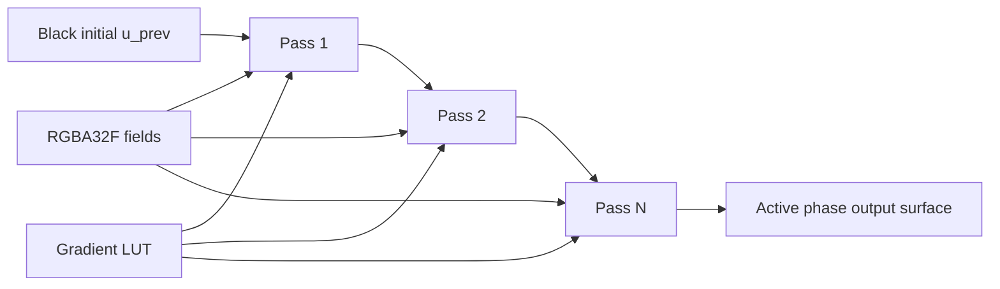

# Mandelbrot Architecture Reference

Audit date: 2026-07-22

Audited tree: the current local worktree, including its pre-existing modified and untracked files

Validation mode: static source, asset, metadata, and framework-API inspection; the project was not run headlessly

## 1. Purpose, scope, and confidence

This document is the durable mental model for the `Mandelbrot` Bitloop project. It follows the data from a saved example or an interactive edit, through camera/quality invalidation, precision and kernel dispatch, progressive field computation, normalization, GPU upload, the custom multi-pass GLSL layer, and final drawing. It also records the UI, capture, animation, history, statistics, build, auxiliary Cardioid project, dormant kernels, and unversioned experiments.

The audit distinguishes three kinds of claim:

- **Code fact**: directly established by the current worktree. Source anchors are supplied for important paths.
- **Mathematical interpretation**: the formula implemented by the code, independently checked against the recurrence it represents.
- **Visual inference**: a likely connection between an attached full-size image and a current curated bookmark. The supplied full-size WebPs contain no recoverable Bitloop XMP state, so visual matches cannot be called exact.

No simulation behavior was changed as part of this audit. Existing modified and untracked files were treated as the source of truth and left intact. Line numbers refer to this audited worktree and may move after later edits.

## 2. The whole system in one view

`Mandelbrot_Scene` is simultaneously:

1. a Bitloop `Scene<Mandelbrot_Scene>` with buffered UI state and lifecycle callbacks;
2. the live `MandelState`, so serializable options are directly available to compute, shading, and UI code;
3. the owner of four progressive `MandelPhaseData` objects; and
4. the coordinator for camera navigation, compute scheduling, normalization, GPU shading, captures, history, and diagnostics.

Each `MandelPhaseData` owns an `EscapeField`, a `WorldRasterGrid256`, and a `MultiPassShader` (`Mandelbrot/Mandelbrot.h:37-51`). The four grids cover the same world-space camera rectangle but sample it at 27x, 9x, 3x, and 1x pixel spacing. A completed phase becomes visible immediately while finer phases continue in later process calls.


The expensive CPU and relatively cheap GPU work are intentionally separated. Raw orbit-derived features are retained until the Mandelbrot inputs change. Tone controls, normalization choices, gradients, and shader source can therefore produce different images without re-running the escape kernel when their required raw fields already exist.

## 3. Ownership and build boundary

The project is independently configurable and buildable from `projects/Mandelbrot`:

- `CMakeLists.txt` discovers every `.cpp`, `.h`, and `.hpp` below `Mandelbrot/`, creates the Bitloop project, adds `subprojects/Cardioid`, hides the Cardioid project from the parent gallery, and finalizes the target (`CMakeLists.txt:15-26`).
- MSVC applies `/arch:AVX2 /fp:fast` in every configuration, while native GCC/Clang apply their `-O3`, AVX2, contraction, and relaxed math-error/trap flags only in Release. Emscripten applies `-O3`, LTO, `simd128`, relaxed SIMD, and fast math without a configuration guard. The build also requests large-object assembler/object support (`-Wa,-mbig-obj` or `/bigobj`) (`CMakeLists.txt:34-58`).
- `config/build_config.h` enables the dev-facing Mandelbrot UI and Cardioid overlay. It sets the intended camera-easing macro to 1, but the entire easing application/decay `#if` block is itself inside a source block comment and is not compiled. The header disables timer instrumentation, extended field stats, dictionary tuning, bookmark mass updates, and unversioned experiments. `BL_SIMD_FORCE_SCALAR=1` disables the framework helper's x86 SSE/AVX selection; WASM and AArch64 selection is discussed in section 7.4 (`build_config.h:3-24`).
- `vcpkg.json` and `vcpkg-configuration.json` provide package/registry configuration; Bitloop and Brotli support are the important project-level dependencies. Toolchain scripts are generated/project tooling, not simulation logic.
- `subprojects/Cardioid` remains an independently buildable Bitloop project. The Mandelbrot parent only consumes its drawing helpers.

The recursive source glob means unversioned `.h/.hpp` files are visible to the IDE and target source list, but they affect compiled behavior only if included. With `MANDEL_UNVERSIONED_EXPERIMENTAL=0`, `_unversioned/experimental.h` is not included by `Mandelbrot.h`, and its dependent experimental implementations are inactive (`Mandelbrot/Mandelbrot.h:29-31`). Likewise, alternate kernel headers do not become active merely because CMake lists them.

## 4. Top-level lifecycle

### 4.1 Project preparation

`Mandelbrot_Project::projectPrepare()` always declares a stable-ID `source` scene. In `SPLIT_VIEW` it also declares a `linked` Mandelbrot scene whose `SceneLinkOptions` references the source and synchronizes camera, quality, and style. Camera, quality, style, and kernel selection are independent one-way synchronization options. The layout mode controls scene creation only; runtime compute behavior follows each scene's link policy. `Config::load_example_name` is copied into the scene but is not currently assigned or consumed. Each scene owns its Mandelbrot-specific resources; there is no global simulation singleton.

### 4.2 `sceneStart()`

Startup (`Mandelbrot.cpp:23-58`) performs process-lifetime initialization in this order:

1. lets Bitloop choose the maximum practical thread count with `Thread::setMaxThreads(0)`;
2. copies every already-registered snapshot preset alias into the state's `valid_presets` map;
3. creates the initial gradient and font resources;
4. installs the initial shader source into every phase's `MultiPassShader`;
5. initializes phase-duration moving averages; and
6. loads the hard-coded initial compressed `MandelState`.

This final load is why member initializers in `Mandelbrot.h` are not, by themselves, the startup recipe. `sceneMounted()` then calls `focusWorldRect(*ctx, ...)`, using the mounted Viewport's dimensions to rewrite camera position, zoom/stretch, and rotation. The hard-coded state's non-camera recipe survives, while its camera portion is replaced by the home view. On web, a later `?data=` load happens after that focus call and can restore an encoded camera.

### 4.3 `sceneMounted()`

Mounting (`Mandelbrot.cpp:72-94`) needs the actual viewport. It:

- sets the camera view center and fits the initial `[-2.25,-1.25]..[0.75,1.25]` world view to the mounted Viewport;
- configures each grid from that Viewport's transient camera projection during processing (actual world-quad/field sizing happens in the first process pass);
- configures `CameraNavigator` for direct panning and a zoom range from `1e-4` through `1e62`;
- on web, conditionally loads a `?data=` state after focusing the home view; and
- creates the initial undo/redo checkpoint.

The maximum zoom is consistent with the project selecting `fqd` for its deepest coordinate work.

### 4.4 Per-update process pipeline

`viewportProcess()` is the orchestration spine (`Mandelbrot.cpp:147-223`). Its order matters:

1. temporarily blocks capture until the frame is known complete;
2. advances locally owned animation/steady zoom, then applies one-way linked-scene camera, quality, style, and kernel-selection synchronization;
3. refreshes the snapped surface/world quad from the effective camera;
4. derives the enabled kernel feature mask, refreshes quality/precision, and resolves the fractal formula plus compute backend;
5. detects Mandelbrot-affecting changes and resets compute;
6. updates phase dimensions after viewport resize;
7. resumes or completes one compute phase;
8. updates shifted gradient and detects normalization-only changes;
9. calculates normalization information and normalizes the active raw field when needed;
10. pushes changed user shader source into all four phase shader chains;
11. authorizes snapshot/record capture only when the correct completed frame exists;
12. processes history, gathers statistics, and runs optional experiments;
13. requests a redraw for reshading or overlay changes, and immediate updates while mouse/camera-velocity flags say interaction is active (the stored velocity is not currently applied/decayed).

The key invalidation classes are:

| Change class | Examples | CPU orbit field | Normalize/upload | GLSL chain |
|---|---|---:|---:|---:|
| Mandelbrot input | camera, iteration limit, stripe frequency, enabled ITER/DIST/STRIPE set | reset/recompute | yes, at phase completion | yes |
| Normalization/tone | cycles, log blend, distance sharpness/invert/tone, stripe phase/tone | retained | redo | yes |
| Normalization sampling | sample scale, quality, exponent, precision | full reset in current tracked list | yes | yes |
| Optimized-interior debug | `maxdepth_show_optimized` | full reset in current tracked list | yes | yes |
| Gradient transform | marks, shift, hue, flatten/reverse/invert | retained | retained | redo only after `gradient_changed && frame_complete` requests it |
| Shader source | pass text/directives | retained | retained | rebuild/re-render |
| Overlay only | axes, alignment crosshair, normalization points, Cardioid | retained | retained | retained; redraw composite |

`mandelChanged()` and `normalizationOptionsChanged()` are the authoritative tracked-field lists (`core/mandel_process.hpp:435-475`). The history system has a separate, deliberately incomplete set; see section 14.

### 4.5 Draw and destruction

`viewportDraw()` (`Mandelbrot.cpp:249-349`) re-runs the active phase's shader chain only when `reshade` is set. It then applies the camera transform and draws the final shader surface over the active grid's full world quad. Optional axis (suppressed above zoom `1e7`), alignment, normalization-sample, experimental, and Cardioid (suppressed above `1e6`) overlays are drawn afterward. Startup instructions are compiled only outside `BL_DEBUG` and drawn last in stage space.

`sceneDestroy()` queues deletion of each phase's feature texture, the gradient LUT, and all bookmark thumbnail textures with `threadQueue().post()` in GUI runs; headless runs clean up directly. Bitloop waits for queued teardown cleanup on the render thread before deleting the scene, keeping its fields alive until cleanup completes. `MultiPassShader` separately queues deletion of its black 1x1 texture by capturing its handle by value in its destructor; owned `ShaderSurface` destructors release their framebuffer, output texture, VAO, program, and NanoVG image.

## 5. Scene data model

### 5.1 Live serializable state versus runtime state

Because the scene inherits `MandelState`, these are live, serializable presentation inputs:

- camera x/y/zoom/stretch/rotation;
- dynamic/fixed iteration policy and quality;
- interior-forwarding mode;
- ITER, DIST, and STRIPE weights and their feature-specific normalization/tone controls;
- shader source and gradient marks/transforms;
- animation enable flags and increments;
- normalization field parameters; and
- capture-filter choices.

Runtime-only orchestration includes scene-link policy, selected/resolved fractal formula and compute backend, the four fields/grids/shaders, current and starting phase, tile progress, inferred precision, timers, moving averages, reshade/renormalize flags, navigator velocity, history, textures, statistics, UI editor buffers, and Cardioid/diagnostic display state.

This distinction explains two important behaviors:

- a bookmark can recreate an image recipe without storing millions of field pixels; loading invalidates and reconstructs them;
- a serialized enum can fail to recreate hidden runtime state if load code does not derive it. The interior-forwarding contract/expand arrays currently have exactly that problem (section 9.5).

### 5.2 Phase-owned state

For phase `p`, `phases[p]` owns:

- `field`: raw `EscapeFieldPixel` objects, skip flags, aggregate ranges/means, and its normalized RGBA32F GPU texture;
- `grid`: mapping between phase raster indices and the shared world rectangle using high-precision positions;
- `shader`: parsed pass definitions, one `ShaderSurface` per pass, and the final output surface.

Only one phase is `computing_phase`; the last completed phase is `active_phase`. The same phase may be both when a computation finishes. Accessors in `Mandelbrot.h:107-117` centralize this distinction.

## 6. Progressive computation and responsiveness

### 6.1 Four spatial phases

`phaseDownscaleFactor()` returns `3^(PHASE_COUNT-phase-1)`, producing 27, 9, 3, and 1 (`core/conversions.h:32-38`). `updateFieldSizes()` rounds the full surface up to a multiple of 27, then sizes each raster and field by its downscale factor (`core/mandel_process.hpp:162-199`). Rounding prevents fractional phase dimensions and makes every coarse sample align exactly with one child-grid center.

All phases represent the complete camera rectangle. They differ in sample density, not world coverage:

| Phase | Linear spacing | Pixel count relative to final | Purpose |
|---|---:|---:|---|
| `PHASE_27X` | 27x | 1/729 | near-immediate whole-view preview |
| `PHASE_9X` | 9x | 1/81 | early refinement |
| `PHASE_3X` | 3x | 1/9 | high-detail preview and interior evidence |
| `PHASE_1X` | 1x | 1 | final capture-quality field |

The comments at `Mandelbrot.h:166-168` still describe an older three-phase 9x/3x/1x layout; the enum, constructor array, conversion, and current sizing code establish the actual four-phase design.

### 6.2 Reset, adaptive starting phase, and activation

`resetCompute()` (`mandel_process.hpp:236-259`) moves `next_starting_phase` into `starting_phase`, resets the computation cursor/tile progress, clears `final_frame_complete`, clears normalization-point final flags, resets every field, and restarts phase timing. It deliberately leaves `active_phase` and `frame_complete` intact until a newly computed phase is promoted, preserving the last coherent visible result. It does not free/reallocate phase storage unless sizing changed.

`processCompute()` (`mandel_process.hpp:261-404`) dispatches the current phase, records elapsed work, and immediately promotes a finished phase to `active_phase`. It then either advances to the next phase or marks the final frame complete.

The start phase adapts from observed performance. Phase timing predicts final-phase cost using moving ratios (`core/conversions.h:19-30`):

- if the coarse result predicts a final result below roughly 1500 ms, the next full invalidation may begin one phase later;
- if later evidence predicts above roughly 1750 ms, the policy moves back toward the coarser start.

This is a latency optimization across interactions, not a quality reduction in the current settled frame: later phases still run through 1x unless work is interrupted by a new change.

### 6.3 Multi-frame tile ownership

`TileBlockProgress` persists work ownership across process calls. The field is divided into 64-by-8 pixel microblocks. With `M` workers, worker `k` claims block indices `k, k+M, k+2M, ...`; each owner's cursor advances only after its block completes. A timeout is tested between blocks, then all blocks already in flight are joined before returning.

Consequences:

- completed blocks are not recalculated when the phase resumes next frame;
- no mutex is needed for pixel writes because block ownership is disjoint;
- the timeout is cooperative and coarse-grained: interruption latency is bounded by the slowest currently executing block and its per-pixel kernel, not by one orbit iteration;
- deterministic block ownership avoids two threads racing the same field pixel.

The compute timeout policy (`Mandelbrot.cpp:125-145`) gives the first/cheap or steady-zoom pass no artificial stop, gives active interaction about 128 ms, and otherwise grants about 256 or 512 ms depending on expected expense/precision. This lets input and UI regain control without abandoning accumulated phase work.

That budget scopes only the tiled raster traversal. Perturbation rebuilds/downcasts the full reference orbit before the budgeted call, and both backend families run normalization samples afterward without that deadline. Phase forwarding/morphology is serial and unbudgeted; phase-completion normalization/upload and GLSL rendering are later still. Thus the slowest block bounds only raster-segment overrun, not end-to-end process latency. `field_compute_ms` and adaptive phase timers also bracket only raster work, so their final-cost prediction excludes reference-orbit and normalization-sample time.

### 6.4 Reusing samples between phases

When interior forwarding is not Slowest, a 3x refinement maps coarse pixel `(x,y)` to child `(3x+1,3y+1)`. Both are the center of the same world-space cell, so `processCompute()` copies the completed coarse `EscapeFieldPixel` there before finer computation. `computeMandelbrot()` treats a nonnegative depth as already calculated and skips it. This is exact sample reuse, not interpolation. The current guard disables this exact center copy together with approximate mask forwarding in Slowest mode, so Slowest recalculates every finer pixel.

The remaining child pixels normally require fresh orbits. Interior forwarding can mark larger proven-interior areas for later skipping; section 9 explains its morphology and trade-off.

### 6.5 What partial results do and do not show

The pending phase is not continuously uploaded block-by-block. A phase becomes active and is normalized/reshaded when it completes (or when presentation options change on an already complete active phase). Thus the user sees stable whole-view refinements rather than a visible sweep of half-computed blocks. A new input can abandon the pending phase and retain the last coherent active image until a new coarse phase completes.

## 7. Precision ladder and kernel dispatch

### 7.1 Why the ladder starts at f64

`MandelFloatType` contains only F64, F128, and F256 (`core/types.h:7-12`). The source comment records the measured design choice: f32 offered no performance advantage in this implementation and enlarged the compile-time dispatch tables. `Mandelbrot_Scene::T_lo` is therefore `f64` (`Mandelbrot.h:70-74`).

The framework camera type includes f32, so scene-to-camera selection offsets the Mandel enum by one when configuring precision. This preserves the local compact three-entry dispatch domain while selecting the corresponding framework F64/F128/F256 camera representation.

### 7.2 Thresholds

`getRequiredFloatType()` (`core/conversions.h:66-86`) selects by normalized camera zoom:

| Required feature set | F64 while zoom is below | F128 while zoom is below | Otherwise |
|---|---:|---:|---|
| no DIST | `1e11` | `5e28` | F256 |
| includes DIST | `2e10` | `1e28` | F256 |

DIST lowers both thresholds by five because the derivative/distance result is more precision-sensitive than a plain escape count. The values are empirical project policy, not universal numerical limits; comments and the user's stated experiments identify performance as the reason for using the least costly type that remained visually reliable.

Comparisons use strict `<`, so equality at a threshold upgrades to the next type.

### 7.3 What is actually high precision

For F128/F256 perturbation, high precision `T` is used to construct world coordinates, perform analytic interior checks, establish the camera/reference anchor, place normalization samples, and build the reference orbit. The per-pixel perturbation delta, down-converted reference steps, derivative recurrence, stripe accumulation, and most normalized field math use `T_lo=f64` or f32 storage. If the dev UI explicitly selects `NO_PERTURBATION` at F128/F256, the ordinary per-pixel kernel does use full selected `T`; AUTO avoids that expensive combination.

This is the central performance technique: pay extended precision once for the common reference path and coordinate differences, then evolve many nearby pixels with hardware-friendly doubles. It is not an arbitrary-precision orbit for every pixel.

The installed fltx v0.1.10 types are floating-point expansions, not IEEE binary128/binary256:

| Type | Representation | Significand precision | Approx. decimal digits | Exponent range |
|---|---|---:|---:|---|
| f64 | one double | 53 bits | 15-16 | double |
| fdd | unevaluated `hi + lo` pair | 106 bits | about 31 | double |
| fqd | four ordered double components | 212 bits | about 63 | double |

fltx implements error-free transforms and locally protects them from unsafe reassociation/FMA contraction. fqd arithmetic is often deliberately out-of-line, reinforcing why multiplying it by every pixel and every iteration is much more expensive than amortizing one reference orbit. Expansion precision increases significand resolution but not exponent range.

At the navigator's `1e62` cap, an order-one full-HD view needs pixel spacing around `1e-65`. That is slightly below fqd's nominal 63 decimal digits, so adjacent coordinates can become marginal/collapse near the extreme cap. This is a numerical-capacity inference, not a reproduced rendering failure.

### 7.4 Formula and backend defaults

Fractal semantics and execution strategy are separate dimensions. `FractalFormula` currently contains only `MANDELBROT`; `ComputeBackend` selects `DIRECT`, scalar `PERTURBATION`, or `PERTURBATION_SIMD_UNROLLED`. `ComputeBackend::AUTO` is excluded from the compile-time dispatch table by sharing the `COUNT` value. Runtime deduction chooses:

- `DIRECT` at F64;
- `PERTURBATION_SIMD_UNROLLED` at F128 and F256.

This matches the experimental-performance intent described in the request: direct double arithmetic wins before coordinate cancellation requires a reference orbit, while the unrolled perturbation path amortizes high-precision work at deep zoom. The ordinary scalar perturbation kernel remains selectable in the dev UI for comparison.

`BL_SIMD_FORCE_SCALAR=1` is important context. The unrolled kernel's `simd2` packages the complex x/y lanes and exposes convenient vector-like operations; it does not currently process two independent pixels at once. Its major optimization is the manually expanded group of eight dependent iterations, not wide multi-pixel SIMD.

The force switch disables x86 SSE/AVX selection in the current framework helper. WASM and AArch64 may still use their native two-lane pair types; even there, the lanes are one pixel's real and imaginary components. AVX2 build flags can still benefit unrelated compiler-generated code, but this abstraction does not batch multiple Mandelbrot points.

### 7.5 Dispatch dimensions

Separate compile-time tables specialize the hot paths without forming irrelevant formula/backend products:

- coordinate type: f64, fdd, fqd;
- feature mask: every nonempty combination of ITER, DIST, and STRIPES;
- formula entry point: Mandelbrot;
- Mandelbrot compute backend: direct, scalar perturbation, unrolled perturbation;
- normalization flags: depth normalization, distance inversion, and optimized-interior visualization.

Feature specialization removes unused derivative or stripe operations from the inner recurrence. The nonempty-domain assumption is material: setting all three UI weights to zero can currently derive `KernelFeatures::NONE`, which is outside `bl_enum_domain_traits<KernelFeatures>` and is listed as a risk in section 18.

Enabling DIST is not semantically isolated to the green channel. It raises bailout radius from 8 to 32, so the stopping step, stripe sample count, smooth escape value/offset, and final orbit used by distance all change together. A field computed without DIST cannot simply synthesize a reliable DIST channel afterward.

### 7.6 Line-level audit: direct kernel

The following tables account for every executable group in the active direct kernel. Adjacent declarations are grouped only where they implement one indivisible algebraic step.

#### `mandel_step()` (`kernels/kernel_mandel.hpp:7-17`)

| Lines | Exact purpose |
|---|---|
| 7-9 | Template and forced-inline function boundary. `T` is normally f64 in the auto direct path, but the helper is type-generic. `z` is mutated; `c` is constant for the pixel. |
| 10-13 | Expands complex squaring and caches `x^2`, `y^2`, and `x*y`. Caching avoids recomputing products after `z.x` is overwritten. |
| 15 | Writes real part `x^2-y^2+c_x`. |
| 16 | Writes imaginary part `2*x*y+c_y` as `xy+xy`, avoiding a separate multiply by a literal. |

#### `mandel_step_and_derivative()` (`kernel_mandel.hpp:19-44`)

| Lines | Exact purpose |
|---|---|
| 19-20 | Same orbit step plus in-place parameter derivative `dz/dc`. |
| 22-24 | Saves old `z`; the derivative recurrence must use `z_n`, not the newly written `z_(n+1)`. |
| 26-29 | Four real products for complex multiplication `z*dz`. |
| 31-32 | Forms its real and imaginary parts. |
| 34-35 | Applies `2*z*dz+1`; `+1` belongs only to the real part of the complex constant one. |
| 37-40 | Reuses the saved old `z` for the ordinary Mandelbrot square. |
| 42-43 | Writes `z_(n+1)=z_n^2+c`. |

#### `kernel_mandel()` (`kernel_mandel.hpp:46-120`)

| Lines | Exact purpose and hot-path implication |
|---|---|
| 46-51 | Specializes by coordinate type and compile-time feature mask. `if constexpr` later removes derivative, smooth-ITER, and stripe code that is not requested. |
| 53-54 | Materializes the feature-dependent squared bailout and typed zero/one constants once. DIST selects radius 32; other masks use radius 8. |
| 56-58 | Initializes `z_0=0`, `c=(x0,y0)`, and derivative `d_0=1`. The derivative seed is correct for the code's update-before-orbit-step ordering: first update gives `2*0*1+1=1`. |
| 60-61 | Initializes completed-step count and cached squared magnitude. |
| 63-69 | Starts the unbounded loop and selects derivative-aware or plain recurrence entirely at compile time. One recurrence step is always performed before testing escape. |
| 70 | Counts that completed step. |
| 72-73 | Calculates `|z|^2` once for stripes and the termination test. |
| 75-81 | When STRIPES exists, converts `z/|z|` to f32 cosine/sine and accumulates the requested angular multiple. f32 deliberately limits cost for a presentation signal. |
| 82 | Stops after escape or after consuming the allowed iteration count. Short-circuit ordering is immaterial here because both operands are cheap. |
| 85 | Rechecks whether this was a genuine escape. The additional `iter < iter_lim` creates the last-iteration discrepancy noted in section 18: radius crossing on step `iter_lim` is treated as non-escape. |
| 87-96 | DIST-only finalization. For escape, computes `r=|z|`, `|dz/dc|`, and `r*log(r)/|dz|`; a zero derivative maps to zero instead of division by zero. Non-escape gets `-1`. |
| 98-103 | Writes the large interior sentinel and returns early. The stripe call marks escape with `r2=0`, which is unsafe log input and is a confirmed sharp edge. |
| 105-112 | ITER-only continuous depth. `0.5*log(r2)=log(|z|)`; `iter+1-log2(log|z|)` is the smooth count; the precomputed bailout offset makes the two radii comparable; negative numerical tails clamp to zero. |
| 113-116 | If ITER is not requested, retains integer escape count for internal completeness without logarithms. |
| 118-119 | Finalizes stripe interpolation using the actual squared radius at escape. |

There is no hidden periodicity check in this kernel. Apart from the main-cardioid/period-2 precheck in the caller, a nonescaping exterior-near-boundary/interior point consumes `iter_lim` steps.

### 7.7 Line-level audit: stripe accumulation

`StripeAccum` is hot because it is touched once per orbit iteration whenever STRIPES is enabled (`field/escape_field.h:10-146`).

| Lines | Exact purpose |
|---|---|
| 10-14 | `mul_angle(c,s,n)` treats `(c,s)` as a unit complex number and initializes exponentiation-by-squaring accumulators. It computes `(cos(theta)+i sin(theta))^n`, avoiding `atan2`, multiplication by frequency, and another sine call per iteration. |
| 16-29 | For every set bit of integer frequency `n`, complex-multiplies the result by the current base. An FMA path reduces instructions/rounding when available. |
| 31-39 | Shifts to the next exponent bit and squares the complex base. The early break avoids an unnecessary final square. |
| 41-42 | Returns `cos(n*theta)` and `sin(n*theta)`. |
| 70-83 | Stores frequency, sample count, sums, last sample, log-radius, and escape state. The last sample is retained for smooth interpolation across the escape boundary. |
| 85-95 | Converts the current unit direction to its frequency multiple, accumulates sine/cosine, remembers the last contribution, and increments the sample count. |
| 97-107 | On escape, stores `log(r^2_escape)` and sets the escape flag. Overloads avoid unnecessary caller conversion. |
| 109-112 | Non-escape resets only the log value; it does not set `escaped=false`, relying on fresh/reset object state. |
| 115-120 | Returns zero for no samples; otherwise rotates the average by user phase `(cphi,sphi)` and maps the signed wave to `[0,1]`. The apparent sine/cosine cross-order defines the chosen phase convention. |
| 122-129 | Recomputes an average excluding the last orbit sample, or uses the full average for a one-sample orbit. |
| 131-138 | Derives the same fractional escape position used by smooth coloring, clamps it, and only enables it for a recorded escape. |
| 140 | Interpolates previous-sample average toward full average so stripe bands do not jump at integer escape boundaries. |
| 142-145 | Applies a gentle centered `tanh`, clamps floating error, and returns the raw stripe scalar. |

### 7.8 Line-level audit: reference orbit

#### Packed reference data (`kernels/ref_orbit.hpp:5-35`)

Each `RefStep<T_lo>` is aligned and packs `2*Z_n`, high-precision-downcast `Z_(n+1)`, and squared bailout slack. `_pad` makes the structure layout friendly for paired loads. `RefOrbit<T>` temporarily owns the high-precision pre/post sequences and escape metadata; `RefOrbitLo<T_lo>` is the compact f64 hot-loop representation plus a raw pointer that avoids repeated vector access machinery.

#### `build_ref_orbit()` (`ref_orbit.hpp:37-84`)

| Lines | Exact purpose |
|---|---|
| 37-41 | Specializes the high-precision orbit by feature-dependent bailout and defines typed zero. |
| 43-48 | Records reference parameter and clears all prior path arrays. |
| 50-52 | Reserves at most `iter_lim` entries so the hot construction loop does not repeatedly reallocate. |
| 54-55 | Defaults to a nonescaped, full-length reference. |
| 57-58 | Starts `Z_0=0` at reference parameter `C`. |
| 60-64 | Iterates and saves the pre-step `Z_n`; perturbation needs `2*Z_n` in its delta recurrence. |
| 65-70 | Applies the same Mandelbrot step, saves `Z_(n+1)`, and caches its high-precision squared magnitude. |
| 72-78 | On the first escape, records one-based iteration, marks escape, and stops: no reference step beyond the safe escape path is useful. |
| 81-83 | Converts escape count/vector length into the last usable zero-based post-step index and protects the empty/degenerate case. |

#### `downcast_orbit()` (`ref_orbit.hpp:86-123`)

| Lines | Exact purpose |
|---|---|
| 86-92 | Sizes the low-precision packed array and obtains the actual escape radius (not squared). |
| 94-100 | Converts high-precision pre/post coordinates to f64. This one-time precision loss is deliberate: only the common reference was expensive to construct. |
| 102-105 | Computes radial headroom `max(0, ER-|Z_(n+1)|)` and squares it. This bounds how large a perturbation may grow before the combined point can approach/cross the bailout differently from the reference. |
| 107-114 | Packs `2*Z_n`, `Z_(n+1)`, slack squared, and zero padding. Precomputing `2*Z_n` removes two multiplies per pixel per iteration. |
| 119-122 | Copies the safe final index and exposes contiguous data through `step`. |

### 7.9 Line-level audit: scalar perturbation kernel

The active scalar implementation is `mandel_kernel_perturb()` (`kernels/kernel_mandel_perturb.hpp:8-172`). Let `C` be the reference parameter, `c=C+dc`, `Z_n` the reference orbit, and actual pixel orbit `z_n=Z_n+delta_n`. Expanding squares gives:

`delta_(n+1) = delta_n * (2*Z_n + delta_n) + dc`.

Every hot line is an explicit real-arithmetic form of this identity or of a guard that keeps it numerically useful.

| Lines | Exact purpose and invariant |
|---|---|
| 8-22 | Declares the low-precision kernel, feature constants, and squared bailout. The `V2` alias is unused in this scalar body. |
| 24-25 | Starts at reference step zero and clamps the stored last-safe index against negative metadata. |
| 27-30 | Optional diagnostic print for the first normalization point; this is active overhead/output only when caller passes `first=true`. |
| 32-40 | Initializes `delta_0=0`, derivative `d_0=1`, and previous actual `z_0=0`. |
| 42 | Runs at most `iter_lim` actual-orbit steps. |
| 44-51 | DIST-only derivative update `d_(n+1)=2*z_n*d_n+1`, using the actual previous orbit, not reference `Z_n`. The four real terms are fused algebraically into two temporaries before assignment. |
| 53-57 | Loads packed reference step and its cached `2*Z_n`. |
| 60-69 | Forms `(2*Z_n+delta_n)` and complex-multiplies by `delta_n`, then adds `(dcx,dcy)`. Temporaries preserve old `dx,dy` until both new components are known. |
| 71-76 | Adds the new delta to stored `Z_(n+1)` to recover actual `z_(n+1)`. |
| 83 | Computes actual squared magnitude once. |
| 85-92 | STRIPES-only unit direction and accumulation, identical in intent to direct kernel. |
| 94-103 | Checks escape and always computes smooth depth in f64, guarding log inputs with `1e-300`. `n` is zero-based, hence completed count is `n+1` and formula begins `n+2`. |
| 104-114 | Computes exterior distance from actual radius/derivative when enabled; otherwise explicitly writes zero. |
| 116-120 | Finalizes stripes and returns after escape. The boolean return currently signals completion, not escape status: nonescape also returns true. |
| 124-126 | Measures perturbation magnitude `|delta|^2` and starts rebase decision. |
| 128-130 | Rebase after consuming the last safe reference step, preventing next-loop reference overrun. |
| 132-139 | Rebase when `|delta|^2 > 0.75^2 * slack^2`; the 0.75 safety factor leaves headroom before the reference's bailout boundary. |
| 141-146 | Pauldelbrot/dominance test near a critical point: if actual `|z|^2` is smaller than `0.95*|delta|^2`, cancellation makes the current reference a poor center. |
| 148-160 | Re-centers against `Z_0=0`: sets delta to actual current `z`, resets reference index, preserves actual previous z for derivative, and continues without advancing reference. This is algebraically valid because `z = 0 + delta` at the new reference origin. |
| 162-164 | Normal case: advance reference and remember actual `z_(n+1)` for next derivative update. |
| 167-171 | Exhausted iteration budget: set interior sentinel, DIST `-1`, and stripe no-escape state, then report kernel completion. The current active function calls `stripe.escape(0)` rather than `no_escape`, as noted earlier. |

The reference is not a fixed-length approximation that silently runs past failure. The three rebase rules deliberately reset the representation whenever reference exhaustion, bailout slack, or critical-point cancellation makes that representation unsafe.

### 7.10 Line-level audit: unrolled perturbation kernel

`mandel_kernel_perturb_simd_unrolled()` (`kernels/kernel_mandel_perturb_simd_unrolled.hpp:8-119`) has the same recurrence and most of the same decisions. Its macro body accounts for exactly one orbit step:

| Lines | Exact purpose |
|---|---|
| 8-25 | Declares feature constants, bailout/log floor, indices, delta, derivative, and previous actual z. |
| 27-30 | Disables Clang's additional automatic loop unrolling; the source controls unroll size explicitly. |
| 32-34 | Outer loop and one-step macro definition. |
| 36-42 | DIST path packs `(z_x,z_y)` and derivative, complex-multiplies `2*z*d`, adds `(1,0)`, and unpacks. With scalar-forced `simd2`, this is one complex number in two lanes, not two pixels. |
| 44-50 | Paired-loads `2*Z_n` and `Z_(n+1)`, evaluates the perturbation recurrence with `cmul`, and writes the new delta. |
| 52-54 | Reconstructs actual z and obtains its squared magnitude by dot product. |
| 56-61 | Optional f32 stripe sample. |
| 62-79 | Escape, smooth depth, optional distance, optional stripe finalization, and immediate return. |
| 81-92 | Delta magnitude plus reference-end, slack, and dominance rebase tests. Unlike scalar, slack rebase is applied only when `lim2>0`. |
| 93-98 | On rebase, increments the completed iteration `n`, resets reference index, stores actual previous z, and `continue`s the outer loop from inside the macro block. |
| 100-101 | Normal completion increments both iteration and reference indices. |
| 104-111 | Expands eight copies, testing `iter_lim` between the first seven. The eighth falls naturally back to the outer condition. This reduces loop-control/branch overhead without violating the dependence between iterations. |
| 114-118 | Nonescape finalization uses interior sentinel, DIST `-1`, and the safer `stripe.no_escape()`. |

Manual unrolling does not make the recurrence parallel: each `delta_(n+1)` is needed by the next step. It improves instruction scheduling and amortizes branch/loop bookkeeping. Interruption also remains outside this pixel kernel, so a high-iteration pixel or its eight-step group cannot observe the frame timeout mid-orbit.

### 7.11 Cross-kernel semantic differences

The active kernels aim at the same field but are not byte-for-byte equivalent:

| Case | Direct | Scalar perturbation | Unrolled perturbation |
|---|---|---|---|
| escape on final allowed step | classified interior | escaped | escaped |
| `iter_lim==0` | executes one step | executes none | executes none |
| mask lacks ITER | stores integer depth | still calculates smooth depth | still calculates smooth depth |
| smooth offset helper | f32-valued | f32-valued | f64-valued |
| escaped stripe radius stored as | f32 | f64 | f64 |
| interior stripe finalizer | `escape(0)` | `escape(0)` | `no_escape()` |

AUTO crosses from the first to the third behavior at the f64/fdd threshold, so these small differences can become visible at a mode boundary independently of coordinate precision.

## 8. Raw field semantics

### 8.1 `EscapeFieldPixel`

An escape-field pixel carries the raw outputs needed by all presentation recipes:

- `depth`: escape iteration or smooth escape depth; the large sentinels represent interior/skipped-interior;
- `dist`: distance estimate derived from the final orbit and parameter derivative;
- `StripeAccum`: angular orbit-history sums, sample count, final sample, and escape metadata;
- normalized `final_depth`, `final_dist`, and `final_stripe`, plus optional extended statistics when that build flag is enabled.

Finality is not stored in `EscapeFieldPixel`: `NormalizationPixel::is_final` belongs to the separate normalization sample set. Progressive interior skip state likewise lives in `EscapeField::skip_flags`, a separate per-field vector rather than a pixel member (`field/escape_field.h:191-225`; `field/normalization_field.h:8-30`).

Raw results are stored independently of the user's final weight. A feature is computed only if its weight enables the corresponding `KernelFeatures` bit. Changing from a zero to nonzero weight therefore changes the kernel feature set and requires field recomputation; changing a nonzero weight changes only ratios and presentation.

Feature removal is intentionally lazy. `updateEnabledKernelFeatures()` upgrades immediately when a new bit is needed, but retains an old now-unweighted bit until another Mandelbrot change already requires recomputation. Its normalized channel becomes zero immediately through the ratio, while avoiding a field reset solely to save future kernel work. On the next camera/frequency/quality change the mask is downgraded.

### 8.2 ITER

ITER is a continuous escape-time field when smoothing is enabled by the kernels. Its value is based on

`iteration + 1 - log2(log(|z|)) - bailout-dependent offset`.

The offset makes the result comparable despite using radius 8 for ordinary iteration/stripe work and radius 32 when DIST is enabled. The raw normalization range is measured from the normalization samples. Presentation can floor to discrete bands, blend linear and `log1p` mappings, cycle, and optionally normalize depth.

In dynamic-cycle mode, cycle size is based on `iter_cycle_value * mandelbrotIterLimit(zoom)`, the project's assumed base limit, rather than the exact configured/final `iter_lim`.

### 8.3 DIST

DIST is the standard Mandelbrot exterior distance estimate

`|z| * log(|z|) / |dz/dc|`,

where `dz/dc` follows `d_{n+1}=2*z_n*d_n+1`. The kernel uses a larger radius when DIST is requested so the asymptotic estimate is better formed. Normalization begins from a zoom-scaled physical window (approximately `0.1/zoom` through `10/zoom`), applies logarithmic mapping, sharpness/easing, pivoted gamma/contrast/brightness, optional inversion, and cycling.

### 8.4 STRIPE

STRIPE samples an angular stripe function along the escaped orbit using the unit direction of `z` and a user frequency/phase. `StripeAccum` retains the running contribution required for a smooth average rather than a single final-angle band. The normalization field derives a weighted mean phase; the rendered value is resolved relative to that mean, scaled by a hand-fit magnitude curve over `log10(zoom)`, then tone-adjusted and cycled.

Locking the stripe mean during steady zoom avoids a normalization reference that changes from frame to frame and would otherwise look like global phase flicker.

### 8.5 Interior values

Normalized exterior pixels receive their three feature channels. Interior pixels become a negative depth marker; forwarded/optimized interiors can use a second negative marker when the dev visualization is enabled. The fragment wrapper interprets `iter < 0` as interior black before calling user code, with the special deeper negative debug value shown magenta. This prevents arbitrary user shaders from accidentally coloring the set interior unless the wrapper itself is changed.

For an interior pixel, normalization writes only `final_depth` before returning; older `final_dist`/`final_stripe` storage may remain. The wrapper's early mask executes in every pass before those channels reach `userShade`, so the stale values are currently unobservable to user GLSL.

## 9. Interior detection and forwarding

### 9.1 Exact cheap tests

Before expensive iteration, `interiorCheck()` tests the exact main-cardioid and period-2 bulb inequalities. Points satisfying either are known members and receive the interior sentinel immediately. These are analytic fast paths, not heuristic rejection.

### 9.2 Phase morphology

After a phase completes, its known-interior mask can be transformed before forwarding to the 3x finer field:

1. contract/erode the coarse mask by the selected radius, retaining a conservative interior core;
2. expand/dilate around that core by the selected radius; and
3. map the result into the child phase, in addition to exact center-pixel copies.

`EscapeField::expandSkipFlags()` first produces the dilation outline (`dilated AND NOT original`) and, when not overwriting, unions that outline back with the original. Combined with contraction this behaves like an opening-style core plus controlled ring.

On intermediate phases the propagated mask is evidence for the next morphology stage; it does not replace every current-phase orbit. A finer orbit that computes an exterior pixel updates that pixel's field value but does not directly clear an inherited `skip_flags` bit. Subsequent contraction may remove that coarse evidence, but morphology—not the computed exterior classification—is what invalidates it. When forwarding into the final phase, marked pixels receive `INSIDE_MANDELBROT_SET_SKIPPED`, so broad proven/assumed interior regions avoid their full-resolution orbit. That final skip is the major performance win.

### 9.3 Presets

The UI callback assigns these contract/expand triples for the three phase transitions:

| Mode | 27x -> 9x | 9x -> 3x | 3x -> 1x | Character |
|---|---:|---:|---:|---|
| Slowest | disabled | disabled | disabled | lossless reference path |
| Slow | `(7,0)` | `(6,2)` | `(8,2)` | conservative |
| Balanced | `(5,0)` | `(5,3)` | `(7,3)` | current runtime default arrays |
| Fast | `(2,0)` | `(1,0)` | `(1,0)` | aggressive; documented sharp-angle loss |

The names explicitly communicate that Fast can lose thin/sharp interior geometry. This is a deliberate quality/performance control rather than an invisible approximation.

### 9.4 Exact versus approximate reuse

The child center copy is exact because it reuses the same world coordinate. Forwarding surrounding skip flags is conservative only to the extent that the erosion radii remove uncertain boundary pixels. Increasing speed reduces that safety margin. Conceptually these mechanisms have different correctness properties, although the current outer `interior_forwarding != SLOWEST` guard enables/disables both together.

### 9.5 Current load-state gap

The serialized key `Q` restores the `MandelInteriorForwarding` enum, but the `contract_expand_phases` arrays are runtime-only and are assigned only inside the UI combo callback. Loading a non-Slowest bookmark changes the label/enum without deriving its matching radii; the arrays remain whatever the current session previously held (initially the Balanced-looking `{5,0},{5,3},{7,3}`). Only the disabled-versus-enabled distinction is reliably reconstructed. This is a confirmed state-derived-runtime mismatch, not a proposed design change.

## 10. Normalization and GPU field upload

### 10.1 Sampling geometry

`NormalizationField::setShape()` calls the framework's misleadingly named `delaunayMeshEllipse()`. The helper actually lays out a hexagonal disk grid and radially warps normalized radius `r` to `r^exponent`; it is not a Delaunay triangulation used by later code. The disk is centered on the camera with world radius `(normalization scale / zoom) * 2`, and each sample receives weight `1 - |warped normalized position|`. Sample world positions retain the selected high-precision coordinate type.

Sample spacing is `(1/quality)/500`. Current controls therefore range from roughly 2,300 points at quality 0.1 to roughly 227,000 at quality 1.0. Scale changes geographic reach, exponent changes central concentration, and quality changes count. The separate precision/tolerance setting governs whether a perturbation normalization point may reuse a nearby completed raster pixel or needs an exact orbit; the direct-kernel normalization branch ignores that reuse tolerance.

The separate sampling field makes global ranges/means stable and cheap relative to scanning every rendered pixel. It can also be previewed as weighted points in the viewport.

### 10.2 Statistics derived from samples

`calculate_normalize_info<T,F>()` runs the appropriate kernel on normalization points and derives:

- ITER minimum and maximum;
- DIST's zoom-relative window, adjusted by sharpness/tone controls (DIST does not use the normalization samples for its bounds);
- STRIPE's weighted circular/phase mean and zoom-dependent magnitude;
- optional histograms and pivot statistics only when their UI panels request them.

At deep zoom the same high-precision anchor/reference machinery is used for these points. A completed raster pixel is reused only when the perturbation path's distance/tolerance test accepts it; otherwise an exact point is calculated. The exact perturbation path has its `is_final=true` assignment commented out, so those points are recalculated on every resumed compute chunk. Reference data is likewise rebuilt for each chunk. The proximity comparison is dimensionally suspicious: an already squared distance is multiplied by phase scale once, then compared with a squared tolerance.

### 10.3 Per-pixel normalization

`normalize_field<T,F,...>()` computes normalized ITER/DIST/STRIPE values using the weight ratios from `shadingRatios()`. The ratios sum to one; if all raw weights are zero this helper locally falls back to ITER, although kernel-feature derivation does not share that fallback. The resulting texture channels are already cycled, toned, and multiplied by these ratios; they are not unweighted raw observables. A custom shader can use DIST/STRIPE only while its UI weight remains nonzero, and cannot recover their unweighted value.

The field is uploaded as an RGBA32F 2D texture with channels:

| Channel | Value |
|---|---|
| R | normalized ITER / negative interior marker |
| G | normalized DIST |
| B | normalized STRIPE |
| A | currently zero |

The feature texture uses nearest filtering and clamp addressing. Nearest preserves a phase's exact computed cells. Pass outputs are also currently nearest-filtered because `ShaderSurface::setFilter()` is a no-op; recipes that want resampling or blur implement their taps explicitly in GLSL.

### 10.4 Gradient texture

`GradientTexture` rasterizes the edited `ImGradient` into a cached 3072x1 RGBA8 LUT with linear sampling and clamp addressing. Gradient shifting wraps mark positions; hue shift changes mark colors. `sampleGradient()` itself clamps, so cyclic recipes explicitly call `wrap01()` first.

### 10.5 Tone managers

DIST uses `ToneManager<f64>` and STRIPE uses `ToneManager<f32>`. Each maintains min/max/mean/pivot information and a 1024-entry gamma lookup, then applies contrast about the pivot and brightness. The UI displays the reciprocal convention for gamma, so the number a user edits and the exponent stored/applied must not be casually interchanged.

## 11. Custom multi-pass GLSL abstraction

### 11.1 Source language

`MultiPassShader` turns one user text document into one or more generated GLES 3.00 fragment shaders (`shading/multi_pass_shader.h`). Directives live in comment lines:

| Directive | Scope/effect |
|---|---|
| `// @global` | subsequent code is shared before generated pass functions |
| `// @pass name` | begins a named pass |
| `// @scale value` | parses an intended pass resolution scale before body code; current framework setter is a no-op |
| `// @filter value` | parses an intended pass texture filter; current framework setter is a no-op |
| `// @enabled false` or `0` | parses the pass but makes it return the previous color |
| `// @end` | stops further parsing |

Metadata is recognized only before the first ordinary line for that pass; even a blank ordinary line locks metadata. `@enabled` recognizes only the exact false spellings `0`, `false`, and `False`. Pass names are labels rather than buffer identifiers: duplicates/empties are accepted, and only linear previous-pass access exists.

The intended no-`@pass` fallback is currently broken. Before a pass exists, lines have already been appended to global code, then the fallback also uses the script as `userShade` body. This can duplicate statements/`return` at global scope; a trailing newline can also leave its parsed body empty. Every working bundled state uses an explicit `@pass` and avoids this path.

### 11.2 Generated API

Every generated pass receives:

```glsl
vec4 userShade(vec4 prev, float iter, float dist, float stripe, vec2 uv)
```

The wrapper provides:

- `u_features`: immutable normalized ITER/DIST/STRIPE texture;
- `u_gradient`: 1D gradient LUT;
- `u_prev`: previous pass output, or a black 1x1 input for the first pass;
- `u_outTexel`: inverse output pixel size used for neighbor sampling;
- `min_iter/max_iter`, `min_dist/max_dist`, `min_stripe/max_stripe`;
- `clamp01`, `wrap01`, `samplePrev`, `sampleGradient`, and `boundary` helpers.

The user returns a color; the wrapper enforces debug/interior colors before invoking it for normal exterior pixels. `#line` directives try to map compiler errors back to user-source lines.

### 11.3 Pass execution

Each parsed pass owns a persistent full-phase-resolution `ShaderSurface`. Rendering binds the unchanged field/gradient textures and the previous pass output, draws a full surface, then hands that surface to the next pass. The last surface is `outputSurface()` and is drawn once over the phase world quad. This is a linear chain of distinct surfaces, not two-surface ping-pong or a named/branching render graph.



Because each pass can read both the immutable features and the accumulated previous color, the abstraction supports base coloring, feature masks, separable blur, glow/bloom, edge extraction, vignettes, and final compositing without adding C++ render code for each look.

Current pass outputs are RGBA8, so every intermediate is clamped/quantized to 8 bits. With four Mandelbrot phases, a five-pass recipe retains five output textures per phase in addition to each phase's RGBA32F feature texture. The first input is a black 1x1 texture. Current `ShaderSurface::setScale()`/`setFilter()` implementations are TODO no-ops, leaving every pass at full active-phase dimensions with the surface's current nearest filtering.

The generated wrapper re-samples `u_features` and re-applies the ITER interior/debug mask on every pass before user code. User scripts therefore cannot write/recolor an output pixel whose feature sample is interior, enforcing a crisp black silhouette. This is not a sampling barrier: an exterior fragment's manual blur taps may still read `u_prev` on the other side of, or within, an interior region, so cross-boundary influence remains possible.

### 11.4 Editor workflow

The desktop ImGui editor uses the vendored `TextEditor` with GLSL language rules plus regex/known identifiers for project directives and fields. It offers additive and multiplicative feature-mixing templates, pass compile diagnostics, cursor/undo behavior, and optional auto-apply. Each keystroke builds a temporary chain and compile-tests every pass; logs are aggregated without pass labels. Test compilation compiles but does not link. Auto-apply and manual Apply are not gated on success, and live phases compile again. Runtime shader replacement is transactional for an existing program, so invalid source can be serialized while an old program remains visibly active; a newly invalid pass can instead have no output texture for downstream `u_prev`.

### 11.5 Typical feature recipes

The three fields are not intended only as RGB channels. Useful scalar recipes visible in current bookmarks include:

- additive phase: `iter + dist + stripe`;
- multiplicative relief: `dist * stripe` or products with ITER;
- interaction interpolation: start with an additive sum, then blend toward pair products such as `stripe * (iter + dist)`;
- masks: threshold one channel or a sampled gradient color to isolate highlights;
- edge/boundary response: use normalized DIST and `boundary()`;
- animated flow: shift gradient/hue or stripe phase without changing camera geometry;
- bloom: isolate bright/colored regions, horizontal blur, vertical blur, then composite against a fresh field-derived base.

This explains why the same mathematical location can produce radically different images: field calculation supplies compact geometric signals, while the shader document is effectively a small post-processing graph.

## 12. Saved state and bookmarks

### 12.1 State representation

`MandelState` version 2 serializes a compact JSON-like object with one-character keys. Camera coordinates and zoom are strings to preserve fqd text precision. Floating values are cleaned for size, keys are emitted without quotes in the pre-compression representation, and the result is Brotli-compressed at high quality using a project dictionary, then encoded in a URL/filename-safe base64-like alphabet. The first encoded character identifies the dictionary version.

Deserialization accepts the compressed form and falls back to raw form. It restores quotes/leading-zero syntax as needed, applies versioned defaults, and contains compatibility transforms for version-0 weights and version-1 animation fields.

### 12.2 Key-to-consumer map

| Key | Loaded attribute | Principal consumers |
|---|---|---|
| `_` | defaults/schema version | compatibility/default selection |
| `f` | packed flags + version | dynamic iters, axis, dynamic ITER cycle, depth normalization, DIST inversion, smoothing compatibility |
| `x`,`y`,`z` | camera center/zoom strings | camera, precision choice, grids, kernels, normalization |
| `a`,`b`,`r` | camera stretch/rotation | camera transform/grid mapping/draw |
| `q` | quality or fixed iteration value | `finalIterLimit()`, reset/compute |
| `Q` | interior-forwarding enum | phase mask forwarding; radii derivation gap in section 9.5 |
| `m`,`n`,`o` | ITER/DIST/STRIPE weights | feature mask, ratios, UI tabs, normalization/shader inputs |
| `S` | shader source | parser, pass surfaces, editor |
| `i`,`l` | ITER cycle/log blend | ITER normalization |
| `d`,`s` | DIST cycle/sharpness | DIST normalization |
| `v`,`j` | stripe frequency/phase | frequency affects kernel; phase affects normalized presentation |
| `E`,`K` | DIST brightness/gamma | DIST tone manager |
| `c`,`e`,`k` | STRIPE contrast/brightness/gamma | STRIPE tone manager |
| `g`,`h` | gradient shift/hue shift | transformed gradient texture |
| `A`,`t`,`w` | animation flags | per-frame animation control |
| `G`,`H`,`W` | animation increments | gradient, hue, stripe animation steps |
| `p` | packed gradient marks | gradient editor/LUT |
| `M`,`N`,`O`,`P` | normalization scale/quality/exponent/precision | normalization sampling field |
| `R` | semicolon-separated disabled capture aliases | capture preset filtering |

The smoothing flag is preserved for old states, but active kernels currently compute the smooth escape form whenever ITER is compiled; its UI control is commented out.

### 12.3 XMP inside WebP

Image captures are self-describing when produced by this scene. `onEncodeFrame()` assigns `serializeState()` to an image frame's payload (`Mandelbrot.cpp:351-356`). Bitloop writes an RIFF `XMP ` chunk containing an XML packet in namespace `https://bitloop.dev/ns/1.0/` with the compressed state in `<bl:save>...</bl:save>`.

A `.webp` bookmark is therefore both:

- a visual thumbnail; and
- the complete compact recipe required to reconstruct the view.

The raw orbit field and pass surfaces are not stored. They are regenerated from the recipe.

### 12.4 Discovery and UI categories

`MandelBookmarkManager` walks `data/bookmarks`, parses a directory prefix like `[2.00]`, removes that prefix for the display name, and loads each WebP's XMP state into a `MandelBookmark`. A bookmark hashes its serialized state to produce its compact base64-like filename. The UI lays the thumbnail textures into expandable category sections and calls `loadState()` when selected.

Current categories/assets are:

| Directory/display category | Current WebPs | Intended role |
|---|---:|---|
| `[1.00] Home Templates` | 5 | approachable starting recipes |
| `[2.00] Curated Examples` | 15 | polished feature/shader demonstrations |
| `[3.00] Fast` | 19 | inexpensive locations/settings |
| `[3.00] Minibrots` | 19 | minibrot-focused locations |
| `[4.00] Slow` | 9 | expensive examples |
| `[5.00] Animated` | 18 | states with active animation controls |

Two categories currently share sort key `3.00`, but storage uses `std::map<float, BookmarkDir>`. One entry overwrites the other during discovery, dependent on directory enumeration order. The assets remain on disk; the manager cannot reliably expose both categories in one run.

The audit decoded all 85 current WebPs, including five untracked bookmark files. Every one is 128x72, has dictionary-v2/format-v2/defaults-v0 XMP, and has no capture-filter `R` entry. Their current content distribution is:

| Category | Zoom range | Feature combinations (count) |
|---|---|---|
| Home Templates | exactly 1 | I 1, DS 1, ID 2, IS 1 |
| Curated Examples | 99.63 to `3.3352e28` | IDS 7, ID 2, DS 3, IS 2, I 1 |
| Fast | `1.5353e4` to `1.3053e28` | IDS 9, ID 7, IS 2, I 1 |
| Minibrots | `1.2506e6` to `1.12887e31` | IDS 5, ID 11, IS 1, D 1, DS 1 |
| Slow | `1.9184e14` to `3.7104e27` | ID 7, IDS 1, DS 1 |
| Animated | 598.83 to `4.36525e34` | I 9, IDS 7, ID 1, IS 1 |

Across the corpus, 76 scripts are base-only, six are `base -> highlight -> blur H -> blur V -> composite`, and three are `highlight -> blur H -> blur V -> composite` with the base reconstructed at the end. Four Curated states, one Minibrots state, and all 18 Animated states enable at least one animation. This confirms that the pass system's elaborate bloom path is used selectively; the normal bookmark is intentionally a compact single-pass recipe.

### 12.5 Loading, creating, and batch rendering

Normal load path:

1. `MandelBookmark::loadFromThumbnail()` reads WebP bytes and extracts the XMP payload;
2. manager/list UI retains the thumbnail texture and serialized data;
3. `UI::launchBookmark()` calls `scene->loadState(data, true)`;
4. `loadState()` assigns serializable fields/camera values, updates editor text, requests a large-jump camera treatment, derives current quality/precision, and lets normal change tracking reset compute.

The dev `Bookmark Active` action serializes the active state, requests a `thumb128x72_hd` image, embeds that same state through `onEncodeFrame()`, creates a memory texture, and adds it to the UI list. `Save All` can persist bookmark files.

There is a timing split in that creation path: the filename/in-memory bookmark hash the state captured before the asynchronous image, while `onEncodeFrame()` serializes the live state again. Animation can advance between them. Seven current animated files have a filename hash that does not match embedded XMP: Curated `UBT8ouH1AQs`; Minibrots `ljPdWuIqZrQ`; and Animated `8uJj9yT7LZk`, `KJgdw9Ro3NA`, `oEWZxt3RewU`, `xfnoSYlR3Z4`, and `Y0XuZJiXPus`. The immediately added in-memory recipe can likewise differ from what reloads from disk. The callback also mutates buffered UI state from a worker path that the source itself marks potentially non-thread-safe.

Batch rendering is intended to iterate a category, load each state, wait for the final phase/capture, then advance. The current code asks the manager for category `"Curated"`, whereas the parsed directory name is `"Curated Examples"` (`core/mandel_process.hpp:7-48`). `find()` consequently inserts/returns an empty list, so the current `Render ALL bookmarks` route is expected to render none.

### 12.6 Exact decoded curated examples

The following states were decoded from current bookmark XMP, not guessed from pixels.

#### `IUY-hl4cFyo.webp`

- Camera: `x=-0.22231500`, `y=0.69706500`, zoom `2.2016e3`, rotation `155`; quality `5`; forwarding `Q=0` (Slowest).
- Fields: ITER weight `0`, DIST `1`, STRIPE `0.17`; DIST cycle `0.15512`, sharpness `99.23564`, brightness `-0.645`, gamma `1.086`; stripe frequency `8`, phase `0.8915`, contrast `0.635`, brightness `0.279`, gamma `1.499`.
- Shader: one base pass, `sampleGradient(wrap01(iter + (dist * stripe)))`. Because ITER is disabled, this is visually a distance field modulated by angular orbit texture.
- Gradient: black -> deep purple -> pink/lilac -> ochre -> pale gold.
- Visual correlation: this is the strongest current counterpart to attached `FLY9ODTU9wY_fhd.webp`; the relationship is visual inference because that full-size attachment lacks XMP.

#### `1-HafNxGVRQ.webp`

- Camera: `x=-0.79305609870851`, `y=0.15406985043675`, zoom `9.7906e8`, rotation `122`; quality `1`; forwarding Slowest.
- Fields: weights ITER `0.83`, DIST `1`, STRIPE `0.2`; ITER cycle `1.716`, log blend `0.993536`; DIST cycle `1`, sharpness `100`; stripe frequency `6`, phase `1.5533`, contrast `1.32`, brightness `-0.033`, gamma `0.835`.
- Shader interpolates an additive base toward `stripe * (iter + dist)` with interaction strength `0.95`, then samples a wrapped gradient.
- Gradient: violet -> black -> cyan-blue -> white -> white, with gradient shift `0.06` and hue animation increment `1.8` present in state.
- Visual correlation: this is the strongest current counterpart to `Qw6FecxLonQ_fhd.webp`.

#### `muKxwfcQIWE.webp`

- Camera: `x=-0.1057320012`, `y=-0.9260512025`, zoom `7.0698e7`, rotation `90`; quality `1.34`.
- Fields: STRIPE only, frequency `8`, phase `5.9341`, high contrast `3.927`; gradient shift `0.85`, hue `36.735`.
- Shader graph: `find_highlights -> blur_h -> blur_v -> composite`. It isolates blue highlights, applies a radius-25 separable triangular blur, then adds a strength-20 tinted bloom over a fresh field-derived base, with aspect-correct vignette and ITER-depth fade. There is deliberately no explicit base pass before highlight extraction; the composite rebuilds the base from features.
- Gradient: black/white/deep green/black/dark neutral/ice blue.

Because this state sets ITER weight to zero, its exterior ITER texture channel is zero. The composite's nominal `iter_factor` is therefore a constant enhancement rather than a spatial depth fade in this exact preset.

#### `kBr5mgymy8c.webp`

- Camera: `x=-0.10576136483`, `y=-0.92631535241`, zoom `9.6275e5`, rotation `90`; quality `1.66`.
- Fields: ITER `0.38`, DIST `0`, STRIPE `1`; stripe frequency `2`, phase `0.576`, contrast `3.802`; normalization scale `4`.
- Shader constructs additive/pairwise terms and enables only a `0.74` STRIPE-by-ITER interaction before wrapped gradient sampling.
- Gradient alternates gray, green, black, white, and black/white marks to create feathery high-contrast bands.

#### `M_f2nKZteI0.webp` / `va0mSei2HTY.webp`

These use the same five-pass luminous recipe with weights ITER `0.31`, DIST `0.26`, STRIPE `0.58`, stripe frequency `6`, and rotation `117`, differing mainly in location/zoom/phase. The base uses the 95% `stripe*(iter+dist)` interaction, a second pass selects cyan/blue highlights, radius-20 horizontal and vertical triangular blurs each take 41 previous-texture samples per pixel, and composite returns `mix(blur,base,0.5)*1.5`. A declared `bloom_strength=5` is unused; the first base pass is also effectively wasted because highlight selection ignores `prev` and composite recomputes base. At FHD the two blur passes alone perform roughly 170 million previous-pass fetches per reshade.

The latter two occupy the closest current green/blue/glow style family to `snap29_fhd.webp`, but no single current curated thumbnail is an exact match. `snap29` appears to combine the feathery green stripe/ITER structure of `kBr5mgymy8c` with the isolated blue-violet bloom language of `muKxwfcQIWE`; that statement is visual inference.

## 13. Animation, tweening, and capture

### 13.1 Lightweight animations

`viewportProcess()` checks `getProject().isPaused()` before advancing animation, steady zoom, batch snapshot states, or permitting capture. Change detection, progressive field computation, normalization, shading, and manual Cardioid-angle invalidation remain outside that check. `onEvent()` permits navigation during a paused tween while retaining its endpoints. These project-side guards prepare for paused refresh; the current framework still skips the processing callbacks while paused, so that refresh requires a separate framework change.

Gradient position, hue, and stripe phase can advance after a final frame. These presentation animations trigger gradient rebuild or renormalization/reshading without orbit recomputation. Stripe frequency is different: it changes samples taken inside the kernel and therefore invalidates the Mandel field.

Animation waits for the final phase, preventing compute and presentation from continuously chasing a changing state. Capture similarly waits for the frame whose field and shader outputs correspond to the state being encoded.

### 13.2 Steady zoom

The steady-zoom path keeps target/current states, expected frames, speed/rotation controls, a locked stripe mean, and optional recording (`core/mandel_tween.cpp`). Fixed iteration settings are capped to 25% of the dynamic recommendation during tweening to limit pathological frame costs; dynamic quality scales normally.

The current `beginSteadyZoom()` implementation serializes the current target, stores the current zoom, reassigns the same target state, and restores that same zoom. The UI describes a start from zoom 1, but no statement sets zoom to 1 in this path. As written, the endpoints begin with the same zoom, so the intended deep-zoom interpolation appears not to be established. It also enables global fixed-frame delta; `endSteadyZoom()` ends recording unconditionally but does not disable that fixed-delta mode.

### 13.3 Capture filters and payload

Capture presets can be enabled/disabled by alias. Deserialization populates a map containing both true and false entries; runtime filtering reads the boolean correctly. Serialization tests only whether an alias key exists, not its boolean value, so a loaded disabled filter is omitted when the state is serialized again. The disabled selection is therefore not round-trip stable.

## 14. ImGui organization, controls, and history

### 14.1 Sidebar structure

`UI::sidebar()` groups controls by user intent (`ui/mandel_ui.cpp:133-173`):

- top-level workflow: **Saving & Loading**, **Examples**;
- active image state: **View**, **Inputs**, **Shader**, **Gradient**, **Animate**, **Quality**, **Capture**;
- diagnostics/development: **Stats**, **Mouse Orbit**, **History**, and optional experimental sections.

The main sidebar content is disabled while tweening, which prevents ordinary UI edits from conflicting with the interpolation owner. The Stop control deliberately re-enables itself inside that scope so the user can terminate the tween.

**Saving & Loading**, **Examples**, and **View** are the three default-open headers; the remaining groups start collapsed. The mobile layout deliberately omits the shader editor, Capture Options, per-feature histograms, interior-forwarding/kernel controls, Mouse Orbit, History, and the normalization/mouse/capture subsections of Stats. The surviving controls therefore form a smaller exploration-oriented UI rather than a one-for-one compressed desktop sidebar.

### 14.2 View

View groups axes/alignment, optional Cardioid display/animation, and exact camera controls. Navigation uses click/touch drag plus wheel/pinch/rotation through `CameraNavigator`. `onEvent()` records smoothed pan/zoom velocities, but the block that would apply and decay those velocities in `updateCameraView()` is commented out. Arrow keys apply fqd `1e-50` coordinate nudges (`Mandelbrot.cpp:400-410`). Unlike `onEvent()`, `onKeyDown()` has no tweening/recording guard, so arrow nudges and history shortcuts can still run in those modes.

### 14.3 Inputs

The input panel starts with the three feature weights, then exposes a tab only when that feature's weight exceeds `0.0001`:

- ITER: dynamic/fixed cycles, logarithmic blend, depth normalization, histogram;
- DIST: inversion, cycle, sharpness, tone controls, histogram;
- STRIPE: frequency, phase, tone controls, histogram.

This grouping mirrors compute ownership: weight zero can remove an entire compile-time feature; subsequent controls only shape an enabled signal.

### 14.4 Shader and gradient

Shader groups source/template/application/compile feedback. Gradient groups mark editing, templates, position/hue transforms, and destructive-looking presentation operations such as flatten, invert, and reverse. Those operations alter only gradient state, not geometry.

Manual gradient edits set `reshade` only when the active phase is complete, so an edit made while a finer phase is still computing waits for that phase boundary. Normalization/tone changes can renormalize the current active field immediately, while shader-source changes force their reshade path regardless of partial finer-phase work (`Mandelbrot.cpp:175-199`).

One UI-stack concern is present in the gradient section: `BeginLabelledBox()` is conditional on a selected mark, while the matching `EndLabelledBox()` is unconditional. Startup selection is normally `-1`; unless the helper explicitly tolerates an unmatched end, this can unbalance ImGui grouping.

### 14.5 Quality and normalization

Quality groups dynamic/fixed iteration policy, numeric quality, interior forwarding/highlight controls, normalization sampling parameters/preview, and dev kernel selection. Inferred active float type/kernel are displayed in Statistics, not this section.

Despite being sampling controls, normalization scale/quality/exponent/precision are included in `mandelChanged()` and currently reset every raw phase. `maxdepth_show_optimized` also forces a full reset even though it ultimately changes presentation of skipped interiors.

### 14.6 Stats and mouse orbit

Histogram work is intended to be demand-driven: visible tabs set worker-side flags and buffered dirty copies avoid transferring every vector. The flags are only reset while the ITER input tab renders, however; collapsing Inputs or using DIST/STRIPE tabs can leave earlier visibility true, so finalized renormalizations may continue rebuilding hidden histograms. ImPlot bins the copied raw vectors.

Mouse Orbit is an on-demand diagnostic: it recomputes and plots the ordinary orbit trajectory under the pointer. A separate `computeOrbitVel()` helper exists but has no call site, so no velocity trace is displayed. The plotted orbit uses a radius-4 diagnostic bailout, unlike the production radius 8/32; this still identifies obvious escape but is not a byte-for-byte kernel trace.

`collectStats()` currently compares stage coordinates with coarse raster dimensions and feeds client coordinates to `pixelWorldPos()`. During coarse active phases, hover stats can be restricted to the coarse pixel rectangle and map the wrong coordinate space. When this bounds test or subsequent lookup fails, prior hover data is left stale rather than cleared.

### 14.7 Undo/redo

History stores up to 100 serialized state checkpoints and supports Ctrl-Z/Ctrl-Y plus a dev list (`ui/history.hpp`). It tracks major recompute options, weights/tone, gradient/shift, and animation enable flags. It intentionally or accidentally omits shader source, hue shift, axes, capture filters, and animation increment values. Parameters passed into `processUndoRedo()` for normalization/gradient status are presently ignored; its internal tracked lists decide checkpoint creation.

## 15. Cardioid auxiliary project

The overlay is separate from the escape kernel's analytic interior check. When enabled and zoom is below `1e6`, `viewportDraw()` always calls `Cardioid::plot(this, ctx, false)` and then `Cardioid::animatePlot(..., ani_angle)` (`Mandelbrot.cpp:307-314`). Thus the Mandelbrot label **Interactive Cardioid** means display plus angle-slider/construction animation; it never enters `plot()`'s pointer-interactive branch. The helpers draw the exact main-cardioid parameterization

`c(t) = 0.5*exp(i*t) - 0.25*exp(2*i*t)`

and an educational construction using the large/small generating circles, points, tangent/perpendicular relationships, and optional angle animation. It neither writes `EscapeField` nor changes membership decisions.

`subprojects/Cardioid` has its own CMake/project/tooling and can run its fuller standalone scenes. `bitloop_hide(Cardioid)` only hides that dependency from the Mandelbrot parent presentation.

### 15.1 Cardioid geometry helpers

The dependency is more than the two overlay calls, although only those calls are used by Mandelbrot:

| Helper | Role |
|---|---|
| `cardioidSquaredDistance(angle,p)` | evaluates the exact parameterized curve and returns squared point distance |
| `originalAngleBinarySearch(p)` | despite its name, performs a coarse ternary distance search (epsilon 0.02) used near the unstable cusp region |
| `originalAngleFromPoint(p)` | Newton-minimizes squared distance to recover closest curve parameter, with the cusp search fallback and wrapped iteration |
| `cardioidPolarCoord(p,...)` | returns closest curve point, original angle, tangent angle `1.5*angle`, and signed perpendicular distance; special-cases the central disk/failed inside projection |
| `fromPolarCoordinate(angle,dist)` | reconstructs a point by offsetting the curve along its perpendicular normal |
| `originalAngleFromPerpAngle` | algebraic inverse of the `1.5*angle - pi/2` perpendicular relation |

`CumulativeCardioid` stores each sampled segment as turning angle plus length, then `computeSegments(angle_mult)` scales accumulated turning while preserving lengths. `CardioidLerper` prebuilds this shape for weights 0..1: zero turning unfolds it toward a straight chain; full turning restores the cardioid. It interpolates morph samples, finds a nearest sampled point by ternary narrowing plus a final linear scan, converts a point to approximate `(angle, signed normal distance)`, and projects those coordinates back onto any morph weight.

### 15.2 Standalone scenes

The exported `plot()` draws the exact red outline and, in interactive mode, the generating circles/points and perpendicular projection. Exported `animatePlot()` draws the two-circle construction, p1/p2, tangent, and normal-offset arrow for a supplied angle.

`Cardioid_Scene` builds the morph lookup, owns its camera/navigation/animation UI, draws either the cumulative flatten morph or the exact construction, and permits capture frames only after animation advances. `Cardioid_Graph_Scene` rasterizes a half-resolution signed perpendicular-angle heatmap (negative angle in red, positive in green), overlays the white cardioid, and supports independent navigation. `Cardioid_Project::projectPrepare()` lays out the main scene and adds the graph scene on non-mobile platforms.

In the standalone Cardioid UI, the `interactive` flag defaults false, but its checkbox is rendered only inside the true branch. The false branch exposes angle/animation controls without a way to set `interactive=true`, making that standalone mode UI-unreachable from its default. This does not affect Mandelbrot's direct `Cardioid::plot/animatePlot` calls.

## 16. Dormant and experimental algorithms

### 16.1 Alternate kernel headers

- `kernel_mandel_perturb_simd.hpp`: retained development/debug perturbation implementation; not included by `Mandelbrot.h` and not an active dispatch choice.
- `kernel_mandel_inertial.hpp`: an alternate, nonstandard inertial recurrence experiment; inactive.
- `kernel_newton.hpp`: Newton-basin and hybrid Mandelbrot/Newton experiments, including a large commented historical implementation; inactive and currently stale/source-broken if included directly.
- `mandel_kernel_perturb_orig` and `_32` inside the active perturbation header are retained comparison functions but not selected by the scene's dispatch.

Their presence documents experimentation; it does not expand current runtime capability.

### 16.2 `_unversioned/log_phi_coordinates.*`

This experiment approximates the exterior Boettcher log coordinate using `log(z_n)/2^(n-1)`, carries a derivative, unwraps the complex-log branch, and Newton-inverts a fixed potential/external angle to world coordinates. It can build adaptive, threaded equipotential/flow paths and draw them in red. It is disabled by `MANDEL_UNVERSIONED_EXPERIMENTAL=0`.

### 16.3 `_unversioned/minibrot_atlas.*`

The current atlas experiment uses fdd parameter-plane work, quadtree subdivision, analytic cardioid/bulb pruning, attracting-period detection, Newton center solving, distance-estimate and component filters, cusp/radius estimates, deduplication, streaming, and entry limits. Files in `_unversioned/old/` are design snapshots of earlier strategies. The compile gate is off by default; even if manually enabled, the experiment coordinator's local `enabled_minibrotAtlas` defaults false while LogPhi defaults true, so the atlas still does not run without another code/config change.

## 17. File-by-file disposition ledger

This ledger covers all project-owned code surfaces. Generated build trees and individual binary bookmarks are classified by group rather than pretending their bytes contain source functions.

| Path | Role and active status |
|---|---|
| `CMakeLists.txt` | independent target, recursive source discovery, Cardioid dependency, native/wasm optimization flags; active |
| `CMakePresets.json` | configure/build presets; active tooling |
| `vcpkg.json`, `vcpkg-configuration.json` | dependency manifest/registry; active tooling |
| `tooling/**` | Bitloop discovery, vcpkg merge/autodetect, update scripts, wasm triplet; generated/project tooling |
| `README.md`, `LICENSE` | brief capability/readme and licensing |
| `Mandelbrot/config/build_config.h` | feature/dev/Bitloop compile switches; active |
| `Mandelbrot/config/tween_splines.h` | interpolation curves used by state tweening; active |
| `Mandelbrot/Mandelbrot.h` | scene/project ownership, all runtime members and callback declarations; active |
| `Mandelbrot/Mandelbrot.cpp` | project/lifecycle/process/draw/input/capture orchestration; active |
| `Mandelbrot/core/types.h` | precision, feature, kernel, phase, sentinel, forwarding enums; active |
| `Mandelbrot/core/conversions.h` | escape constants, phase/zoom/height, iteration/quality, precision, weight helpers; active |
| `Mandelbrot/core/compute.h` | tiled field computation, normalization statistics and normalized upload; active hot path |
| `Mandelbrot/core/mandel_process.hpp` | animation, camera/size/quality/feature invalidation, phase scheduler, capture; active |
| `Mandelbrot/core/mandel_tween.cpp` | steady zoom/tween/record control; active but endpoint issue noted |
| `Mandelbrot/field/escape_field.h` | raw pixel structures, field storage, skip morphology, texture upload, ranges; active |
| `Mandelbrot/field/normalization_field.h` | weighted hex-disk/radially warped normalization sampling field and threaded iteration; active |
| `Mandelbrot/kernels/kernel_mandel.hpp` | direct recurrence, derivative, stripes, direct kernel; active hot path |
| `Mandelbrot/kernels/ref_orbit.hpp` | high-precision reference orbit and f64 down-conversion/slack; active hot path |
| `Mandelbrot/kernels/kernel_mandel_perturb.hpp` | scalar perturbation plus retained variants; active selectable path |
| `Mandelbrot/kernels/kernel_mandel_perturb_simd_unrolled.hpp` | eight-step unrolled perturbation; active default deep-zoom path |
| `Mandelbrot/kernels/kernel_mandel_perturb_simd.hpp` | development alternative; inactive/not included |
| `Mandelbrot/kernels/kernel_mandel_inertial.hpp` | alternate recurrence experiment; inactive/not included |
| `Mandelbrot/kernels/kernel_newton.hpp` | Newton/hybrid experiments; inactive/not included/stale |
| `Mandelbrot/shading/shading.h` | tone/range/gamma helpers and field normalization support; active |
| `Mandelbrot/shading/gradient.h` | gradient presets, transforms, LUT texture; active |
| `Mandelbrot/shading/multi_pass_shader.h` | directive parser, GLSL generation, pass surfaces/chaining; active |
| `Mandelbrot/state/mandel_state.h` | serializable fields/default declaration; active |
| `Mandelbrot/state/mandel_state.cpp` | versioned compact serialization/Brotli/dictionary load compatibility; active |
| `Mandelbrot/state/examples.h` | bookmark/model/category/XMP loading, thumbnails, batch and dictionary dev tools; active, tuning gated |
| `Mandelbrot/stats/mandel_stats.h` | diagnostics state, histogram/timing declarations; active |
| `Mandelbrot/stats/mandel_stats.cpp` | field/time/hover collection and Stats ImGui implementation; active |
| `Mandelbrot/ui/mandel_ui.cpp` | all sidebar/editor/input/capture/orbit controls; active |
| `Mandelbrot/ui/history.hpp` | checkpoint, undo/redo, history UI; active |
| `Mandelbrot/external/TextEditor.h` | vendored ImGui text-editor types/API, customized for shader authoring; active third-party |
| `Mandelbrot/external/TextEditor.cpp` | editor rendering/input/undo/colorization/language implementations; active third-party |
| `Mandelbrot/external/TextEditor.h.old`, `TextEditor_old.txt` | local historical artifacts; untracked/inactive |
| `Mandelbrot/_unversioned/experimental.h` | optional experiment coordinator declarations; compile gate off |
| `Mandelbrot/_unversioned/experimental.hpp` | optional experiment init/process/draw/UI wiring; compile gate off |
| `Mandelbrot/_unversioned/log_phi_coordinates.h` | exterior-coordinate experiment types; inactive |
| `Mandelbrot/_unversioned/log_phi_coordinates.hpp` | Boettcher inversion and adaptive path implementation; inactive |
| `Mandelbrot/_unversioned/minibrot_atlas.h` | current atlas types/parameters; inactive |
| `Mandelbrot/_unversioned/minibrot_atlas.hpp` | current atlas algorithms; inactive |
| `Mandelbrot/_unversioned/old/minibrot_atlas - Copy.hpp` | first historical atlas design snapshot; inactive |
| `Mandelbrot/_unversioned/old/minibrot_atlas v2.hpp` | second historical atlas design snapshot; inactive |
| `Mandelbrot/_unversioned/old/minibrot_atlas v3.hpp` | third historical atlas design snapshot; inactive |
| `data/bookmarks/**.webp` | 85 current self-describing thumbnail/state assets across six directories |
| `subprojects/Cardioid/CMakeLists.txt`, presets/manifests/tooling | independent dependency build surface; active tooling |
| `subprojects/Cardioid/Cardioid/Cardioid.h` | Cardioid scene/helper declarations; dependency active |
| `subprojects/Cardioid/Cardioid/Cardioid.cpp` | exact Cardioid geometry, construction animation, and standalone scenes; overlay helper active |
| `build/**`, `.bitloop-workspace` | generated configure/build/dependency caches or workspace marker; not source ownership |

### 17.1 Active function map

The detailed sections above explain the hot functions. This index accounts for the remaining active project functions and their ownership without reproducing vendored TextEditor internals.

| Source | Functions/methods | Responsibility |
|---|---|---|
| `Mandelbrot.cpp` | `projectPrepare` | create/mount the source and optional linked Mandelbrot scene |
|  | `sceneStart`, `sceneMounted`, `sceneDestroy` | initialize state/resources/threads; attach camera/grid/history; release GL resources |
|  | `serializeState`, `loadState` | bridge scene to `MandelState`, precision/editor/large-jump bookkeeping |
|  | `updateComputeTimeout`, `viewportProcess` | latency budget and authoritative per-update pipeline |
|  | `renderShaderChain`, `viewportDraw` | bind field/gradient uniforms, execute passes, draw surface/overlays/HUD |
|  | `onEncodeFrame`, `onEvent`, `onKeyDown` | XMP payload, navigation/easing, precision nudges/history keys |
| `core/conversions.h` | `escape_radius*`, `smooth_depth_offset*` | feature-dependent bailout/smooth constants |
|  | `predictFinalPhaseDuration`, `phaseDownscaleFactor` | phase timing projection and 27/9/3/1 scale |
|  | zoom/height conversions | logarithmic UI/tween coordinate transforms |
|  | iteration/quality helpers | base limit, fixed/dynamic final limit, ratio conversion |
|  | `getRequiredFloatType`, `shadingRatios` | empirical precision tier and normalized field weights |
| `core/compute.h` | `interiorCheck` | exact main-cardioid/period-2 bulb membership shortcut |
|  | `computeMandelbrot` | backend dispatch table, coordinate/reference preparation, normalization probes, tile-resumable field computation |
|  | `resolveStripe`, `toFinalDepth`, `toFinalDist`, `toFinalStripe` | convert retained raw features to shader-facing weighted channels |
|  | `expEase01_poly5`, `clamp01` | fast DIST mapping helpers |
|  | `calculate_normalize_info`, `normalize_field` | global range/mean/tone setup, per-pixel conversion, texture staging |
| `core/mandel_process.hpp` | `loadNextBatchSnapshotState` | advance bookmark batch/load/capture sequence |
|  | scene-link synchronization and shape input capture | copy explicitly grouped source state before invalidation; freeze source `c` per compute reset |
|  | `updateAnimation`, `updateGradient`, `updateCameraView` | cheap state animation, LUT invalidation, snapped surface/world quad (momentum application is commented) |
|  | `updateFieldSizes` | rounded surfaces, phase grids/fields, normalization geometry |
|  | `updateEnabledKernelFeatures`, `updateQuality`, `resolveKernelSelection` | lazy feature-mask policy, precision/iteration/camera precision, formula/backend resolution |
|  | `resetCompute`, `processCompute` | phase state machine, dispatch, timing, reuse/forwarding, finality |
|  | `processCapturing` | snapshot/record permission and post-capture advancement |
|  | `mandelChanged`, `normalizationOptionsChanged` | explicit invalidation ownership lists |
| `core/mandel_tween.cpp` | `beginSteadyZoom`, `updateSteadyZoom`, `endSteadyZoom` | establish/advance/finish temporary zoom and recording state |
| `field/escape_field.h` | `mul_angle`, `StripeAccum::{accumulate,escape,no_escape}`, `stripeFromAccum` | hot integer harmonic and smooth stripe resolution |
|  | `stripeFromAccum_Newton` | dormant Newton-specific resolver |
|  | `EscapeFieldPixel::set` | copy raw results while leaving normalized products regenerable |
|  | `EscapeField::{reset,setDimensions,at/get/safe,has_valid_depth}` | persistent storage/sentinels/indexing/reuse predicates |
|  | skip-flag access, `contractSkipFlags`, `expandSkipFlags` | interior morphology and forwarding masks |
|  | feature-texture methods | RGBA staging, lazy allocation/upload/get/destroy |
| `field/normalization_field.h` | precision-specific `worldPos/setWorldPos` | tagged-union access to f32/f64/fdd/fqd sample coordinates |
|  | `setShape`, `updateField`, `clearFinalFlags`, `forEach` | build/position/weight/reset/thread the normalization disk |
| `shading/gradient.h` | `colorGradientTemplate` overloads | procedural CLASSIC/RAINBOW color evaluation |
|  | `generateGradientFromPreset` | explicit seven-preset mark construction/fallback sampling |
|  | `transformGradient` | copy marks with hue adjustment and wrapped position shift |
| `shading/shading.h` | `ToneFieldInfo::configure`, LUT builders/applicators, pivot adjusters | establish range/pivot and gamma/contrast/brightness mapping |
|  | `ToneManager` methods | own configured tone parameters/LUT and apply normalized/denormalized transforms |
|  | `GradientTexture` methods | lazy RGBA8 LUT ownership/upload/restore/destroy |
| `shading/multi_pass_shader.h` | `ensureBlack1x1Tex`, destructor | own first-pass input texture and queued cleanup |
|  | `updateFragmentSource` | parse directives, generate wrappers, create/reuse pass surfaces/programs |
|  | `render`, `outputSurface` | strictly chain previous texture and expose final surface |
| `state/mandel_state.cpp/.h` | dictionary getters, `getDefaults` | versioned compression vocabulary and omission baseline |
|  | `serialize`, `deserialize`, `_deserialize` | compact JSON-like/Brotli/Base62 save and compatibility load |
| `state/examples.h` | `MandelBookmark` copy/hash/path/load/save/texture methods | one state-bearing WebP thumbnail and GL handle |
|  | `MandelBookmarkList` add/load/hash/category methods | one directory-backed ordered-in-memory list |
|  | `MandelBookmarkManager` ensure/find/at/load/save/repair/destroy | category discovery and aggregate ownership |
|  | dictionary-tuning helpers | gated corpus token scoring/search/initializer output; inactive by config |
| `ui/mandel_ui.cpp` | `dataToURL`, `UI::init/sidebar/overlay/launchBookmark` | sharing, editor/bookmark setup, section composition, deferred load |
|  | `populateSavingLoading`, `populateExamples`, `populateCameraView` | state text/URL/bookmark/camera workflows |
|  | `populateQualityOptions`, `populateInputOptions` | precision/kernel/forwarding/normalization and three field controls |
|  | `populateShaderEditor`, `populateGradientOptions`, `populateAnimation` | programmable presentation and cheap animation controls |
|  | `computeTaperedFitLimits` | fit first 70% of an orbit fully, taper late outlier influence, then pad diagnostic plot axes |
|  | `computeOrbit`, `computeOrbitVel`, `populateMouseOrbit` | pointer diagnostic orbit plot; velocity helper is currently unused |
|  | `populateCaptureOptions` | preset filters, batch rendering, steady zoom/record controls |
| `ui/history.hpp` | `populateHistory`, `processUndoRedo`, `historyOnKeyDown` | history UI, checkpoint policy, Ctrl-Z/Y navigation |
| `stats/mandel_stats.cpp/.h` | table helpers, `populateStats` | conditional diagnostic display and histogram visibility flags |
|  | `syncHist`, `collectStats`, `MandelStats::operator=` | selective histogram/range/hover collection and buffered dirty copy |
| `subprojects/Cardioid/Cardioid.h` | distance/angle/polar helpers | closest-cardioid parameter and signed-normal coordinate conversion |
|  | cumulative/morph helpers | build, interpolate, invert, and project the turning-angle flatten morph |
| `subprojects/Cardioid/Cardioid.cpp` | exported `plot`, `animatePlot` | Mandelbrot-consumed outline and two-circle construction |
|  | `Cardioid_Scene` lifecycle/UI/draw helpers | standalone exact/morphed interactive/animated visualization |
|  | `Cardioid_Graph_Scene` lifecycle/draw helpers | standalone perpendicular-angle heatmap and overlay |
|  | `Cardioid_Project::projectPrepare` | desktop two-scene/mobile one-scene layout |

`external/TextEditor.cpp` implements its own UTF-8 cursoring, selection, editing, undo/redo, clipboard, rendering, tokenization, and language definitions. Mandelbrot depends only on its public editor surface (set/get source, GLSL definition/regex, input/render, logs/cursor/undo); duplicating all 3,000+ third-party implementation lines here would obscure the project-specific architecture.

## 18. Confirmed implementation risks and sharp edges

These findings describe the audited tree. They are not fixes, and severity is about possible effect rather than a request to redesign.

### 18.1 Hot-path correctness/undefined behavior

1. **Final-phase forwarding reference (high confidence/high impact).** `processCompute()` forms `phases[computing_phase+1].field` before checking whether a next phase exists (`core/mandel_process.hpp:333-338`). With forwarding enabled on final phase, merely forming the `phases[4]` reference is out of bounds.
2. **Forwarded child footprint is off by one (high confidence, latent bounds risk).** Child loops use inclusive `<= x0+3` and `<= y0+3` for a destination exactly 3x larger (`mandel_process.hpp:368-376`), creating a 4x4 rather than 3x3 footprint. A flagged last-row/column source would reach `x==width` or `y==height`, where checked access can throw and unchecked skip writes can go out of bounds. The supplied Slow/Balanced/Fast presets always contract more than they expand, which clears source-edge flags before this loop; the invalid access is therefore not currently reachable through those modes, but the loop is a latent bounds defect if future/custom radii preserve an edge flag.
3. **Zero-feature dispatch (high confidence/high impact).** All three weights may be zero, producing `KernelFeatures::NONE`, but the compile-time enum domain asserts/addresses only values 1..7 (`core/types.h:25-38`). `shadingRatios()` has a fallback that feature derivation lacks.
4. **Uninitialized `dist` when DIST is compiled out (high confidence).** A local distance value is still copied into field storage even in feature specializations that do not assign it. Reading/copying the indeterminate value is undefined even if later shaders ignore G.
5. **Reset by byte pattern (high confidence).** `EscapeField::reset()` `memset`s nontrivial `EscapeFieldPixel` objects, including `bool` and `StripeAccum`, with `0x80` to create negative floating sentinels. This relies on object representations and can create noncanonical bool values.
6. **Gamma LUT endpoint (high confidence/routinely exercised).** `applyGammaLUT()` maps exact `x==1` to index 1024, then interpolates with `table[1025]` although the allocation has 1025 elements indexed 0..1024. `final_max_stripe` sends the exact configured upper endpoint through this path on every normalization.
7. **Single-core worker count (high confidence/rare platform).** The framework's `idealThreadCount()` returns `hardware_concurrency()-1` when the hint is nonzero. A platform reporting one hardware thread yields zero; Mandelbrot then uses that value as its compute-tile divisor/worker count.

### 18.2 Numerical/algorithmic consistency

1. **Feature-sensitive precision can stay stale (high confidence).** `viewportProcess()` calls `updateQuality()` before `updateEnabledKernelFeatures()` (`Mandelbrot.cpp:159-165`). Enabling DIST at a fixed view can derive precision from the old feature mask, then reset compute with DIST; quality is not retriggered by that feature change, so the too-low precision can persist until camera/quality/tween/state-load activity.
2. **Direct final-iteration classification differs from perturbation (high confidence).** Direct code reports escaped only when radius exceeded and `iter < iter_lim`; an escape on the last allowed update is classified interior. Perturbation retains it as escaped.
3. **Stripe no-escape cleanup calls escape math with zero radius (high confidence).** Some no-escape paths call `StripeAccum::escape(0)`, entering log/escape calculations before the interior result is later filtered.
4. **All-interior normalization is not guarded (high confidence).** A normalization sample set that is entirely interior divides STRIPE mean by zero, and raw depth maximum remains `numeric_limits::lowest()` while only the minimum receives a fallback. Downstream ranges/uniforms can become nonsensical or NaN.
5. **Normalization perturbation points remain non-final (high confidence).** Their `is_final` assignment is commented, so resumed chunks recompute them.
6. **Perturbation variant rebase criteria differ slightly (high confidence).** The unrolled path gates slack rebasing on positive slack while scalar code does not; edge behavior is not perfectly identical.
7. **Zero iteration limit differs by mode (high confidence).** Direct mode's `while(true)` performs one step even for `iter_lim==0`; perturbation performs none.
8. **Serialized stripe frequency is unvalidated (high confidence).** UI input constrains it to 1..20, but state load does not. A negative signed frequency becomes a huge unsigned exponent in `mul_angle()`.
9. **Perturbation is heuristic, not a proof/fallback (architectural risk).** Reference-end, slack, and dominance rebases reduce known failure modes, but there is no glitch flag, error bound, validation pass, or high-precision per-pixel retry at extreme cancellation.
10. **Normalization edge lookup can alias another row (high confidence).** `EscapeField::get()` validates only flattened `y*w+x`, not x/y separately. The direct normalization reuse path can request outside coordinates; for example x=-1 can silently return the preceding row's last pixel instead of calculating an exact sample.
11. **Normalization reuse tolerance has mismatched dimensions (medium-high confidence).** Its pixel-distance value is already squared, is multiplied once by phase scale, then compared with a squared tolerance.

### 18.3 State/bookmark/UI consistency

1. interior-forwarding mode does not derive its runtime radius table after load (section 9.5);
2. Fast and Minibrots collide at category sort key `3.00` (section 12.4);
3. batch render asks for `Curated`, not `Curated Examples` (section 12.5);
4. disabled capture filters do not survive a re-serialization (section 13.3);
5. the custom gradient base64 encoder has off-by-one tail conditions. Gradients with mark count `2 mod 3` lose the last raw byte (the final mark's alpha); count `1 mod 3` gains an ignored zero. Of 79 bookmark gradients, 31 decode one byte short, 22 one byte long, and only 26 have canonical lengths. Serialization intends alpha 255, but the unchecked loader reads a missing byte into an uninitialized value;
6. `loadFromThumbnail()` is treated as successful by callers even if texture/XMP loading fails, so empty-state entries can be appended; `MandelState::deserialize()` separately reports true after both decode paths fail;
7. compressed-state decode indexes the first byte without protecting empty input and does not catch decode exceptions;
8. `_deserialize()` constructs a string from `string_view.data()` without honoring its length;
9. missing quality `q` falls back to the live pre-load quality rather than the selected schema defaults;
10. version <=1 load does not assign `animate_stripe_phase`, allowing prior live state to leak; unknown defaults versions fall back to member initializers because only version 0 is specialized;
11. `dist_tone_params.contrast` exists but is neither serialized nor deserialized and its UI is disabled; `load_example_name` is stored but never consumed;
12. default/member-initialized state differs from `getDefaults(0)`, so code must use the schema default path consistently. In particular, the member initializer contains an obsolete full-function shader incompatible with the current body-based parser; runtime/versioned defaults normally replace it with an explicit `@pass` script;
13. the steady-zoom endpoints are not established as the UI describes (section 13.2);
14. bookmark/UI helper paths have smaller hazards: missing category in `thumbPath()`, unsorted directory item order, fragile directory-prefix parsing, possible zero thumbnail-column count at very narrow width, and a new memory bookmark without `loaded_path` if saved in-session;
15. bookmark/list hash invalidation does not reliably propagate to the manager, assignments can retain cached target hashes, and thumbnail GL IDs are shallow-copied without an ownership wrapper;
16. `launchBookmark()` captures a `string_view` in a deferred lambda; current backing storage normally survives, but the lambda does not own its payload;
17. XMP insertion XML-escapes payloads but extraction does not unescape them. Current Base62 payloads avoid reserved XML characters; future raw payloads would not round-trip;
18. gradient UI likely has an unmatched labelled-box end when no mark is selected; selection UID is not cleared by gradient presets;
19. the no-`@pass` fallback duplicates body text into global scope and can produce an empty fallback body, so explicit passes are effectively required;
20. `@scale` and `@filter` parse successfully but their framework setters are no-ops; every intermediate remains full phase resolution and nearest-filtered;
21. `u_outTexel` is derived from global viewport output rather than active phase/pass dimensions. Blur neighbor distance is wrong at 27x/9x/3x and for high-SSAA captures;
22. `boundary()` can divide by zero when its source min/max collapse;
23. editor test compilation does not link and neither auto nor manual Apply is gated on success. Invalid serialized source can leave old programs visibly active or give a new pass texture zero;
24. every pass re-applies the hard ITER interior mask, which prevents writes/recoloring at interior output pixels but does not stop an exterior fragment from sampling previous-pass pixels across the boundary; it is an API constraint, not a complete bloom barrier;
25. each distinct pass/phase retains an RGBA8 texture, so long chains quantize between passes and multiply GPU memory; there is no ping-pong reuse;
26. shader-surface GL isolation does not cover every binding/render state, allocation can disturb texture binding, and FBO completeness is not checked. These are context-sensitive integration risks, not a reproduced failure;
27. the camera-easing macro is set to 1, but its complete application/decay `#if` block is inside a source block comment and is not compiled. Navigation still stores nonzero `cam_vel_*`; process then requests immediate updates while they remain nonzero and history refuses checkpoints until they are zero. Button-up clears only moving-average buffers, so an interaction can leave endless updates and history blocked;
28. `beginSteadyZoom()` enables the platform's global fixed-frame delta, while `endSteadyZoom()` does not restore it to false;
29. the Normalization Accuracy revert widget passes the current variable as both current and initial pointers; its separately captured initial value is unused, so Revert cannot restore the starting value;
30. `onKeyDown()` lacks the tween/record guard used by pointer/touch events, permitting camera nudges and history changes while those modes own state;
31. histogram visibility flags can remain true after their panel is hidden, continuing expensive rebuilds;
32. failed hover-stat lookup retains old data, presenting stale pixel information;
33. standalone Cardioid's interactive checkbox is inside the already-interactive branch, so the mode cannot be entered from its default false state.

### 18.4 Diagnostics/performance opportunities, not behavioral defects

- The high-precision reference orbit is rebuilt on each timeout-resume chunk rather than cached.
- Adaptive phase timers measure only tiled raster traversal, omitting reference construction and normalization probes; predictions can understate total process cost.
- The reference builder calculates and stores `|Z|^2`, then recalculates `z.mag2()` for the escape test, adding two redundant high-precision products per step.
- Smooth escape logarithms remain in perturbation specializations even when ITER is disabled.
- The active scalar perturbation path contains a first-normalization-sample debug print condition.
- A latent alternate callback branch in `NormalizationField::forEach()` captures its loop index by reference; the active callback signature chooses the safe branch.
- Shader auto-apply can propagate a compile error before explicit validation.
- The unrolled header leaves `MANDEL_KERNEL_UNROLLED_BODY` defined after the function.
- Long STRIPE orbits naively accumulate f32 sine/cosine sums; zero/f32-underflow magnitude can produce `0 * infinity` NaNs in direction normalization.

## 19. Mental checklist for future changes

Before changing this project, answer these in order:

1. Does the option change the orbit recurrence/reference/field feature set, or only interpretation/shading?
2. If it changes raw data, is it represented in `mandelChanged()`, state serialization, history, and bookmark load?
3. Does it alter the feature mask and therefore the precision threshold, bailout radius, derivative, or stripe specialization?
4. Can completed phase centers or conservative interior evidence remain valid across the change?
5. Can its work be split into independently owned blocks with interruption only between blocks?
6. Does every phase need a shader/source/resource update, or only the active phase output?
7. Is a serialized value sufficient, or must load derive runtime-only tables/caches from it?
8. Does capture wait for the final coherent field and shader output before embedding the state?
9. Is the UI control grouped by the kind of invalidation it causes and disabled during tween ownership?
10. Are inactive/experimental headers truly wired into the active include/dispatch path before treating them as capability?

## 20. Capability summary

The current project is a CPU-computed, deep-zoom Mandelbrot explorer with empirical f64/fdd/fqd precision selection, direct and perturbation kernels, analytic interior fast paths, progressive 27x-to-1x refinement, resumable multithreaded tile batches, exact center reuse, configurable interior forwarding, weighted global normalization, and three independent geometric feature fields. Its GPU side is a compact programmable image pipeline: self-describing bookmark states can combine ITER, DIST, and STRIPE through editable gradients and arbitrary chained GLSL passes, including blur, glow, bloom, masks, vignettes, and animation. UI, capture, history, statistics, and an educational Cardioid overlay surround that core.

The architecture's strongest idea is the separation of expensive geometry from cheap image-making. The principal maintenance risk is that some serialized or feature-derived values have runtime companions (precision, forwarding radii, pass metadata, capture maps) that are not always re-derived in the same transaction. Future work should preserve the field/shader separation and progressive reuse while making those derivations explicit and bounds-safe.
